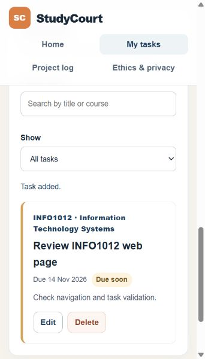

# StudyCourt — study task management website

StudyCourt is a four-page study planner made with HTML, CSS and JavaScript. It helps a student keep course tasks, due dates, descriptions and notes in one place. The site was built for Assignment 3.1 in Information Technology Systems.

## Repository and project structure

The GitHub Classroom repository URL should be placed here after the course invitation is accepted.

```text
index.html                    Entry page for GitHub Pages
source-code/
  html/                       Home, task manager, project log, ethics and privacy
  css/                        Shared responsive styles
  js/                         Image and clock script; task management script
assets/                       Three original study illustrations (SVG)
evidence/                     Planner and troubleshooting screenshots
README.md                     Project guide
LICENSE                       MIT license
```

## Install and run

No package installation or build command is needed.

1. Download or clone the repository.
2. Open the project folder in Visual Studio Code.
3. Open `index.html` with a local web server, such as the VS Code Live Server extension. Alternatively run `python -m http.server 8766` from the project folder and visit `http://127.0.0.1:8766/`.
4. Follow the **My tasks** link. The demonstration login is `student` / `Study2026!`.

The root `index.html` opens `source-code/html/index.html`. All page links and image paths are relative, so the same files work in a local server or GitHub Pages.

## How to use the website

1. On **Home**, read the app summary and use **Next image** to cycle through three study illustrations.
2. Open **My tasks** and sign in with the demonstration credentials above.
3. Complete the required task title, course code, course name, due date and description. Notes are optional. Select **Add task**. If a field is missing or invalid, correct the message shown beside it.
4. Use **Search tasks** to find a title or course. Use **Show** to display all, upcoming or overdue tasks. The summary cards show totals.
5. Select **Edit** on a task, change its details and select **Save changes**. Use **Cancel edit** to leave it unchanged.
6. Select **Delete** and confirm the dialog to remove a task. The page clock appears at the bottom.
7. Read **Project log** for the three-week sprint plan and two documented issues. Read **Ethics & privacy** for data-handling decisions and limitations.

Tasks remain in this browser's local storage after a page refresh. Sign out ends the session but does not clear tasks. Clearing browser data removes them.

## Screenshots



The project log contains screenshots of both issues before and after their fixes.

## Implementation notes

- HTML provides the page structure, labels, navigation and forms.
- CSS gives the pages a consistent design and adapts the layout to narrow screens.
- JavaScript checks input, creates/updates/deletes tasks, filters the list, saves to local storage, cycles the home images and displays the current date/time.
- User-entered task text is inserted with `textContent`, not as HTML.
- The classroom login is client-side. Its credentials are visible in the source and it is **not secure authentication**. Do not enter confidential data. A production system would need server-side authentication and storage protections.

## Credits and references

- Site content and three SVG study illustrations were created for this project.
- CSS layout reference: [MDN CSS grid layout](https://developer.mozilla.org/en-US/docs/Learn_web_development/Core/CSS_layout/Grids).
- Date formatting reference: [MDN Intl.DateTimeFormat](https://developer.mozilla.org/en-US/docs/Web/JavaScript/Reference/Global_Objects/Intl/DateTimeFormat).

## License

MIT. See [LICENSE](LICENSE).

